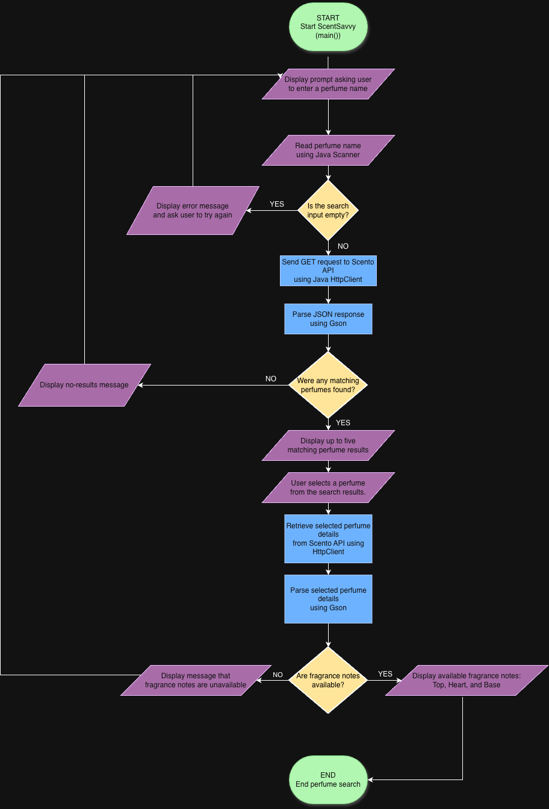

# ScentSavvy

A Java command-line application that helps users discover perfumes and explore their fragrance notes.

## The Problem

Finding accurate fragrance information can be difficult because perfume notes are often scattered across different websites. Many people wear perfumes they enjoy without really knowing what scents make up the fragrance or what notes they are smelling. ScentSavvy aims to make this easier by allowing users to find a perfume, explore its fragrance notes, and learn more about what they are wearing in one place.

## How It Works

- The user enters a perfume name through the command line.
- ScentSavvy searches for the perfume using the Scento API.
- The application displays up to five matching perfume results.
- The user selects the perfume they are looking for.
- ScentSavvy retrieves the selected perfume's details and displays its available fragrance notes, including top, heart, and base notes when provided.
- The application handles invalid searches and missing fragrance information.

### System Diagram

## Tech Stack

- **Language:** Java
- **Libraries:** Gson for JSON parsing.
- **Java Packages:** HttpClient for API requests and Scanner for user input.
- **External API:** Scento Perfume API.
- **External Tools:** curl for testing API requests and jq for inspecting JSON responses.
- **Development Environment:** IntelliJ IDEA.

## Setup

ScentSavvy is currently in the planning and initial development stage. Full setup instructions will be added once the Java application is implemented.

Planned setup:
1. Install the required Java JDK.
2. Clone the public GitHub repository.
3. Open the project in IntelliJ IDEA.
4. Configure the Gson dependency.
5. Run the Java application.

## Usage

Usage instructions and examples will be added once the application is implemented.

The planned application will allow users to:
1. Enter a perfume name.
2. View up to five matching search results.
3. Select a perfume.
4. View its available fragrance notes.

## Roadmap

- Add perfume brand search to make finding fragrances easier.
- Allow users to compare fragrance notes across multiple perfumes.
- Display more perfume details, such as fragrance family.
- Let users save and manage their favorite perfumes.
- Keep a history of previously searched perfumes.
- Improve search suggestions for incomplete or misspelled perfume names.
- Support different fragrance note formats when top, heart, and base notes are not provided.
- Introduce personalized perfume recommendations based on user preferences.
- Develop a graphical user interface (GUI) for a more interactive experience.

## Author

[rajrajsharma7474-sys](https://github.com/rajrajsharma7474-sys)
