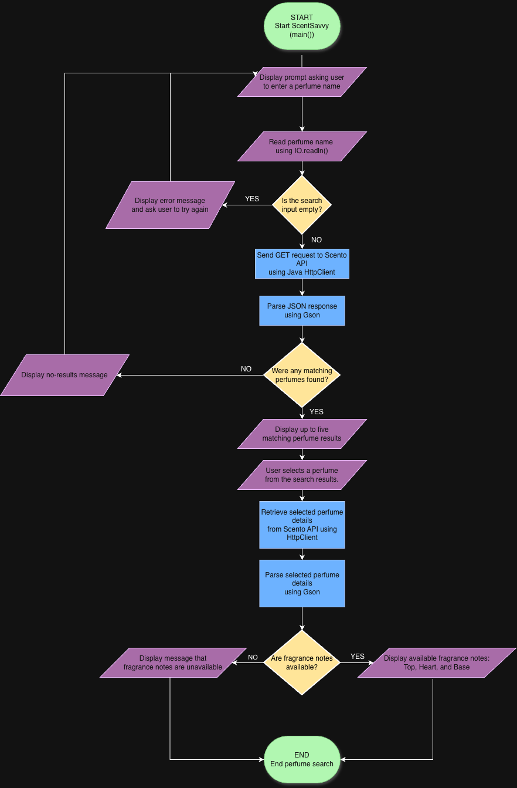

# ScentSavvy

A Java command-line application that helps users discover perfumes and explore their fragrance notes.

## The Problem

Finding accurate fragrance information can be difficult because perfume notes are often scattered across different websites. Many people wear perfumes they enjoy without really knowing what scents make up the fragrance or what notes they are smelling. ScentSavvy aims to make this easier by allowing users to find a perfume, explore its fragrance notes, and learn more about what they are wearing in one place.

## How It Works

- The user enters a perfume name through the command line.
- ScentSavvy searches for the perfume using the Scento API.
- The application displays up to five matching perfume results.
- The user selects the perfume they are looking for.
- ScentSavvy retrieves the selected perfume's details.
- The application displays available fragrance information, including fragrance family, subfamily, character, recommended seasons, recommended times, signature materials, and fragrance notes.
- When top, heart, and base notes are provided, they are displayed separately. Otherwise, available fragrance notes are displayed in an unclassified format.
- The application handles blank input, invalid selections, unsuccessful searches, and API errors.

  
### System Diagram



## Tech Stack

- **Language:** Java 27
- **Libraries:** Gson for JSON parsing.
- **Build Tool:** Maven for dependency management and project builds.
- **Java Packages:** HttpClient for API requests, IO for command-line input and output, and URI/URLEncoder for API requests.
- **External API:** Scento Perfume API.
- **External Tools:** curl for testing API requests and jq for inspecting JSON responses.
- **Development Environment:** IntelliJ IDEA.
- **Data Storage:** No database is used. Perfume information is retrieved from the Scento API when the application runs.


## Setup

**Requirements:**

Before running ScentSavvy, make sure you have:

- Java JDK 25 or newer.
- Maven.
- An internet connection.
- Gson is downloaded automatically by Maven using the dependency in pom.xml. No separate Gson installation or API key is required.

## Installation

Installation and Running

Clone the repository:

``` bash 
git clone https://github.com/rajrajsharma7474-sys/ScentSavvy.git
```

Navigate into the project directory:

```bash 
cd ScentSavvy
```

Check that Java and Maven are installed:

```bash
java --version
```
```bash
mvn --version
```

Compile the project:

``` bash
mvn clean compile
```

Run ScentSavvy directly from the terminal:

``` bash 
mvn org.codehaus.mojo:exec-maven-plugin:3.5.0:java -Dexec.mainClass=Main
```
To rerun ScentSavvy, make sure you are inside the ScentSavvy directory in your terminal and copy and execute the following command:

``` bash 
mvn org.codehaus.mojo:exec-maven-plugin:3.5.0:java -Dexec.mainClass=Main
```


## Usage

After starting the application, enter a perfume name when prompted. ScentSavvy will display matching results and allow you to select a perfume.
Example 1: Searching for a perfume:


Example 2: Searching for a perfume with no matches:


The user can enter another perfume name without restarting the application.
The exact perfume information and search results depend on the information returned by the Scento API.

## Roadmap

- [x] Set up the Java project and connect it to GitHub.
- [x] Implement command-line perfume name input.
- [x] Connect the application to the Scento API using HttpClient.
- [x] Parse API responses using Gson.
- [x] Display up to five matching perfume search results.
- [x] Allow users to select a perfume and retrieve its details.
- [x] Display fragrance notes, including top, heart, and base notes when available.
- [x] Display additional perfume information, such as fragrance family, character, recommended seasons, recommended times, and signature materials.
- [x] Handle invalid input, unsuccessful searches, and API errors.
- [x] Add perfume brand search to make finding fragrances easier.
- [ ] Allow users to compare fragrance notes across multiple perfumes.
- [ ] Let users save and manage their favorite perfumes.
- [ ] Keep a history of previously searched perfumes.
- [ ] Improve search suggestions for incomplete or misspelled perfume names.
- [ ] Introduce personalized perfume recommendations based on user preferences.
- [ ] Develop a graphical user interface (GUI) for a more interactive experience.

## Demo

Final project video walkthrough: [link text](https://youtu.be/d_-J3mrRHS8?si=N9Uoq3HdKzkXIcSg)

## Author

[rajrajsharma7474-sys](https://github.com/rajrajsharma7474-sys)
